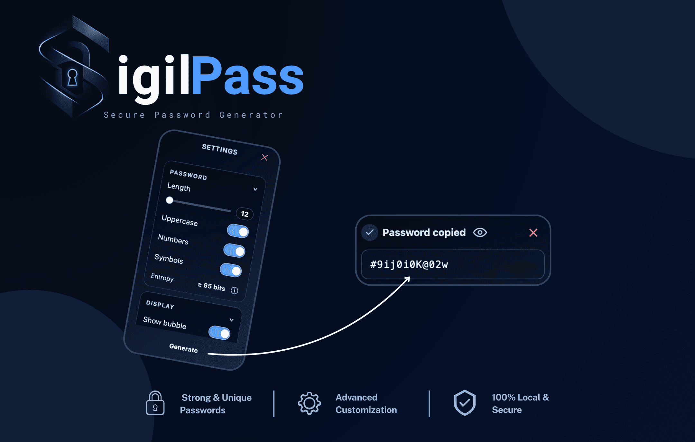

# SigilPass

**Secure, local and customizable password generation directly in your browser.**

 

**[SigilPass](https://greasyfork.org/scripts/541200-sigilpass-robust-random-password-generator)** is a lightweight userscript that generates cryptographically secure random passwords directly in your browser.

Customize password length and character categories, generate passwords instantly, or use **Safer mode** for direct filling without displaying or copying the generated password.

  

---

## Features

### Secure Password Generation

- Cryptographically secure generation using the **Web Crypto API**
- No insecure random fallback
- Password lengths from **12 to 64 characters**
- Optional uppercase letters, numbers and symbols
- Conservative entropy estimate with estimated possible combinations

### Direct Password Filling

- Inline buttons beside detected password fields
- One-click password generation and filling
- Support for login, registration and detected confirmation fields
- Compatibility with controlled inputs such as React forms
- Filling only allowed in a **secure context**

### Safer Mode

Safer mode applies stricter defaults designed to reduce password exposure:

- Minimum password length of **24 characters**
- Lowercase, uppercase, numbers and symbols always enabled
- Direct filling only
- No password preview
- No clipboard copying
- Temporary password references released when leaving or hiding the page

Your Standard mode preferences remain saved when switching between modes.

### Customization

- Themes: Dark (default) and Blue
- Optional automatic clipboard copying, disabled by default
- Show or hide the floating generator
- Show or hide inline password buttons
- Compact settings with collapsible sections
- Instant interface language switching

---

## Languages

SigilPass includes translations for **46 locales** and allows instant language switching without reloading the page.

View the 46 available languages

  
- 🇬🇧 English
- 🇫🇷 Français
- 🇪🇸 Español
- 🇩🇪 Deutsch
- 🇮🇹 Italiano
- 🇵🇹 Português
- 🇳🇱 Nederlands
- 🇷🇺 Русский
- 🇯🇵 日本語
- 🇰🇷 한국어
- 🇨🇳 简体中文
- 🇸🇦 العربية
- 🇵🇱 Polski
- 🇹🇷 Türkçe
- 🇸🇪 Svenska
- 🇷🇴 Română
- 🇻🇳 Tiếng Việt
- 🇮🇳 हिन्दी
- 🇹🇭 ไทย
- 🇭🇰 繁體中文（香港）
- 🇹🇼 繁體中文（台灣）
- 🇲🇾 Bahasa Melayu
- 🇮🇩 Bahasa Indonesia
- 🇧🇩 বাংলা
- 🇮🇳 தமிழ்
- 🇵🇰 اردو
- 🇮🇳 മലയാളം
- 🇮🇳 मराठी
- 🇮🇳 ਪੰਜਾਬੀ
- 🇮🇳 ગુજરાતી
- 🇮🇳 ಕನ್ನಡ
- 🇮🇳 తెలుగు
- 🇱🇰 සිංහල
- 🇰🇭 ភាសាខ្មែរ
- 🇱🇦 ລາວ
- 🇲🇲 မြန်မာ
- 🇳🇵 नेपाली
- 🇪🇹 አማርኛ
- 🇹🇿 Kiswahili
- 🇿🇦 Afrikaans
- 🇪🇪 Eesti
- 🇱🇻 Latviešu
- 🇱🇹 Lietuvių
- 🇮🇸 Íslenska
- 🇮🇪 Gaeilge
- 🇲🇹 Malti

---

## Installation

1. Install a userscript manager such as **[Tampermonkey](https://www.tampermonkey.net/)**.
2. Install **SigilPass** from [Greasy Fork](https://greasyfork.org/scripts/541200-sigilpass-robust-random-password-generator).
3. Open any supported website.
4. Generate a password from the floating button or directly from a password field.

---

## Privacy & Security

SigilPass operates locally and is designed to minimize password exposure.

- Passwords are generated directly in your browser
- No password is stored persistently
- Settings are stored through the userscript manager
- Password generation requires Web Crypto
- The main interface and inline controls use a closed Shadow DOM
- Direct password filling is blocked outside secure contexts

SigilPass is a **password generator**, not a password manager.

A password inserted into a website can still be accessed by that website. Safer mode reduces exposure through the SigilPass interface and clipboard, but it cannot make an untrusted website safe.

---

## Feedback & Contributions

Bug reports, suggestions and contributions are welcome.

- [Greasy Fork Feedback](https://greasyfork.org/scripts/541200-sigilpass-robust-random-password-generator/feedback)
- [GitHub Issues](https://github.com/DREwX-code/SigilPass/issues)

When reporting a bug, include your browser, userscript manager and clear reproduction steps.

**Never include a real password in an issue or discussion.**

---

## Author

Developed and maintained by **Dℝ∃wX**  
GitHub: [DREwX-code](https://github.com/DREwX-code)

---

## License

This project is licensed under the **Apache License 2.0**.  
You are free to use, modify and distribute it in accordance with the license terms.
